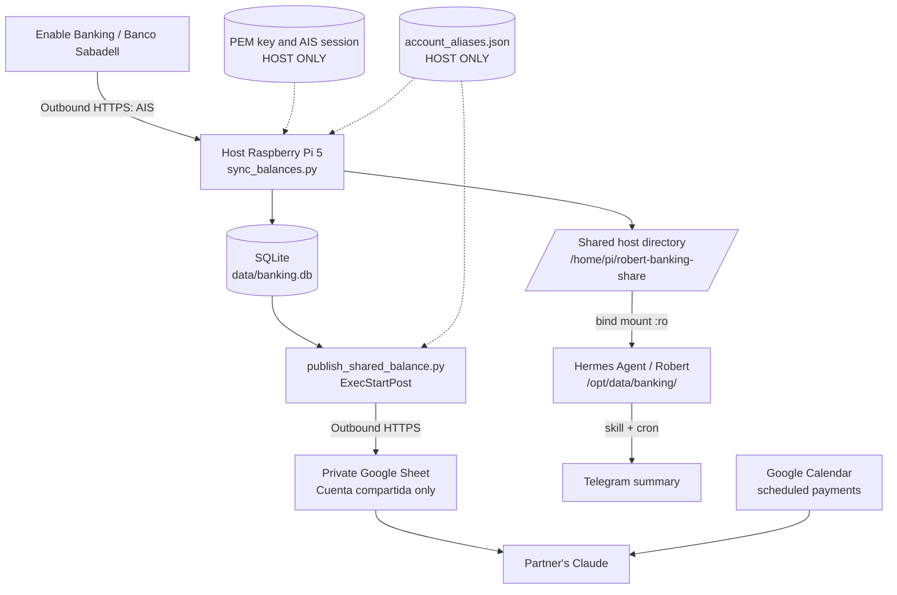

# Robert Banking

**Banco Sabadell balance synchronization with Enable Banking, SQLite, Hermes Agent, and Google Sheets.**

> Personal project for **read-only access to banking information** (AIS). The Raspberry Pi accesses the bank; Hermes/Robert consumes only the resulting files. Separately, **only the booked balance of the shared account** is published to a private Google Sheet. No transfers are initiated and no payments are made.
>
>
> **Scope of this README (November 2026):** the repository structure is based on a screenshot of the project; the data contracts, functions, and default values for `sync_balances.py` are based on its shared source code; `robert-banking.service` and the publisher are based on files shared during development. **The contents of `authorize_sabadell.py`, the `SKILL.md` actually installed, and the effective Hermes `docker-compose`/stack have not been inspected.** The relevant sections provide procedures and **reconstruction examples**, identified as such. Compare them with the current installation before reusing them.

## Table of contents

1. [What it does and does not do](#1-what-it-does-and-does-not-do)
2. [Architecture and data flows](#2-architecture-and-data-flows)
3. [Project structure](#3-project-structure)
4. [Files excluded from Git and how to recreate them](#4-files-excluded-from-git-and-how-to-recreate-them)
5. [Data model, balances, and output formats](#5-data-model-balances-and-output-formats)
6. [Installation from scratch](#6-installation-from-scratch)
7. [systemd service and Linux cron](#7-systemd-service-and-linux-cron)
8. [Shared directory between the Raspberry Pi and Hermes](#8-shared-directory-between-the-raspberry-pi-and-hermes)
9. [`banking-monitor` skill and Hermes cron](#9-banking-monitor-skill-and-hermes-cron)
10. [Publishing to Google Sheets and accessing data from Claude](#10-publishing-to-google-sheets-and-accessing-data-from-claude)
11. [Testing and verification](#11-testing-and-verification)
12. [Common errors and maintenance](#12-common-errors-and-maintenance)
13. [Security, backups, and restoration](#13-security-backups-and-restoration)
14. [References and outstanding items](#14-references-and-outstanding-items)

## 1. What it does and does not do

This project can:

- Periodically retrieve the balances of **two Banco Sabadell accounts** through the Enable Banking AIS API: **Cuenta compartida** (shared account) and **Cuenta personal** (personal account).
- Store a local history of *snapshots* in **SQLite**, ensuring that account identity does not depend on its position in the API response.
- Generate four read-only data artifacts for **Robert**, an agent based on **Hermes Agent** running inside Docker.
- Send a scheduled summary using **Hermes cron** (e.g., via Telegram), taking the figures from the deterministic report generated by Python.
- Publish **only Cuenta compartida** to a private Google Sheet so that another assistant (Claude) can relate its balance to upcoming payments in Google Calendar.

**It does not:** make payments or transfers, modify accounts, download bank transactions in the current version, give Hermes direct access to the bank, or give Claude access to Enable Banking keys.

### Important terminology

- **`CLBD`**: booked balance (*closing booked balance*); **not necessarily equivalent to the available balance**.
- **`XPCD`**: expected balance, if provided by the bank; it must not be labeled as available either.
- **`fetched_at`**: the UTC timestamp when our script finished the request.
- **`reference_date`**: the reference date provided by the bank for that balance; it may differ from the request date.
- **`identification_hash`**: account identifier used to preserve the same account identity across banking sessions.
- **`uid`**: account identifier within an Enable Banking session. **It may change when authorization is renewed**.

## 2. Architecture and data flows




**There are two separate schedulers**, and they must remain independent:

| System | Where it runs | Purpose | Reference schedule |
|---|---|---|---|
| Linux `cron` + `systemd` | Raspberry Pi **host** | Retrieve and persist balances, and publish to Sheets | **07:55, 12:55, and 18:55** every day |
| Built-in Hermes cron | Hermes **container** | Read results and send a report | **08:05** daily: example used for `Robert - Resumen Sabadell`; verify the installed cron job |

No banking HTTP server is publicly exposed: both Enable Banking and Google Sheets are accessed through **outbound connections** from the Raspberry Pi. Hermes reads the locally mounted directory.

## 3. Project structure

Working directory on the Raspberry Pi:

```text
/home/pi/Code_Projects/robert-banking/
├── .gitignore                         # Tracked
├── README.md                          # This document (add to repository)
├── pyproject.toml                     # Tracked: metadata and dependencies
├── uv.lock                            # Tracked: resolved versions
├── authorize_sabadell.py              # Tracked: AIS authorization (CLI not audited here)
├── sync_balances.py                   # Tracked: bank → SQLite → JSON/text
├── publish_shared_balance.py          # Tracked: SQLite → Google Sheet
├── .env                               # IGNORED: local configuration
├── account_aliases.json               # IGNORED: hash → account aliases
├── robert_banking_production.pem      # IGNORED: Enable Banking private key
├── robert_banking_sandbox.pem         # IGNORED: sandbox private key
├── production_session.json            # IGNORED: authorized AIS session
├── sandbox_session.json               # IGNORED: test AIS session
├── google-sheets-service-account.json # IGNORED: private Google credential
├── data/                               # IGNORED: SQLite database and files
│   └── banking.db
├── .venv/                              # IGNORED: uv virtual environment
└── __pycache__/                        # IGNORED: temporary Python files
```


> **Very important:** a file being *ignored by Git* **does not mean it is unnecessary**. Some files can be recreated (such as `.venv` or SQLite), while others require renewed authorization or secure recovery of keys. **The code repository alone is not a complete, operational backup.**

### Files outside the repository

```text
/etc/systemd/system/robert-banking.service    # Host systemd unit
root crontab                               # Starts service 3 times a day
/home/pi/robert-banking-share/                # JSON and TXT generated by host
~/.hermes/skills/banking-monitor/SKILL.md     # Skill in Hermes container/profile
~/.hermes/cron/jobs.json                      # Hermes scheduler jobs
Portainer/Docker configuration            # Shared directory bind mount
Google Cloud + Google Sheet                   # External credential/permission and document
```


The `~/.hermes/...` paths are **internal to the profile running the gateway**; `~` does not necessarily refer to `/home/pi` inside Docker.

## 4. Files excluded from Git and how to recreate them

The screenshot shows these main `.gitignore` rules:

```gitignore
.env
*.pem
*sandbox_session*.json
*production_session*.json
*.db
*.db-*
data/
__pycache__/
.venv/
.pytest_cache/
account_aliases.json
google-sheets-service-account.json
```


If the Google JSON file is moved to `secrets/` in the future, **add `secrets/` to `.gitignore`**: the current rule covers only the exact credential filename, not arbitrary secret JSON files in other locations.

### 4.1 `.env` — local configuration (DO NOT COMMIT)

Representative **production** template, using paths from the existing installation:

```dotenv
# Enable Banking: actual values obtained from the Enable Banking portal
EB_ENV=production
EB_APP_ID=<enable-banking-app-id>
EB_PRIVATE_KEY=/home/pi/Code_Projects/robert-banking/robert_banking_production.pem
EB_SESSION_FILE=/home/pi/Code_Projects/robert-banking/production_session.json

# Local files and data
EB_DB=/home/pi/Code_Projects/robert-banking/data/banking.db
EB_SHARE_DIR=/home/pi/robert-banking-share
EB_ACCOUNT_ALIASES=/home/pi/Code_Projects/robert-banking/account_aliases.json

# Shared account publishing
GOOGLE_SHEET_ID=<document-id>
GOOGLE_SHEETS_CREDENTIALS=/home/pi/Code_Projects/robert-banking/google-sheets-service-account.json
```


`EB_ACCOUNT_ALIASES` is optional: if omitted, `sync_balances.py` reads `account_aliases.json` from the project root by default. The same applies to `EB_DB`, `EB_SHARE_DIR`, `EB_PRIVATE_KEY`, and `EB_SESSION_FILE`, although **explicitly setting production paths is preferable** to avoid accidentally loading the sandbox session (the script's default).

**Environment variables actually read by the scripts:**

| Variable | Used by | Behavior |
|---|---|---|
| `EB_ENV` | Both | `sandbox` or `production`; the publisher rejects anything other than `production` |
| `EB_APP_ID` | `sync_balances.py` | Application identifier used to create the Enable Banking JWT |
| `EB_PRIVATE_KEY` | `sync_balances.py` | Path to the PEM key used to sign the JWT |
| `EB_SESSION_FILE` | `sync_balances.py` | Path to the already authorized AIS session |
| `EB_DB` | Both | SQLite path; defaults to `data/banking.db` |
| `EB_SHARE_DIR` | `sync_balances.py` | Output directory; defaults to `/home/pi/robert-banking-share` |
| `EB_ACCOUNT_ALIASES` | Both, through `load_account_aliases()` | Optional path to environment-specific aliases |
| `GOOGLE_SHEET_ID` | `publish_shared_balance.py` | ID extracted from the Google Sheet URL |
| `GOOGLE_SHEETS_CREDENTIALS` | `publish_shared_balance.py` | Path to the Google service account JSON file |

There is no need to store the shared account hash again in `.env`: it is obtained from the alias mapping.

### 4.2 `*.pem` keys — Enable Banking private key

These are PEM files containing the **RSA private key** associated with the corresponding application/sandbox. `sync_balances.py` reads the key and signs a JWT using the `RS256` algorithm, the header `kid=EB_APP_ID`, audience `api.enablebanking.com`, issuer `enablebanking.com`, and a token lifetime of **1 hour** per execution.

- **Production:** `robert_banking_production.pem`.
- **Testing:** `robert_banking_sandbox.pem`.
- Their exact contents **are neither documented nor copied into the repository**; recover them from authorized encrypted storage or regenerate/register them following the Enable Banking procedure.
- Ensure that the **public key held by Enable Banking matches the local private key**.

Example permissions:

```bash
chmod 600 .env *.pem
```


**Never** paste a real private key into an issue, chat, commit, or example file.

### 4.3 `production_session.json` and `sandbox_session.json` — AIS consent

These files represent the **result of a banking authorization**. Among other fields, the synchronizer requires:

```json
{
  "aspsp": {"name": "Banco de Sabadell"},
  "access": {"valid_until": "<ISO-8601-with-time-zone>"},
  "accounts": [
    {"uid": "<session-uid>", "identification_hash": "<stable-account-hash>"}
  ]
}
```


**Illustrative schema of the subset consumed by `sync_balances.py`; this is not a valid session to copy verbatim, nor is it necessarily the unmodified shape of the API response.** The genuine session produced by the `authorize_sabadell.py` flow must be saved, including the fields required by your synchronizer.

Note one subtlety: the API may return `accounts` as a list of `uid` values, with additional account data in `accounts_data`. The current `fetch_balances()` code accepts `str` or `dict` elements, but **if it receives only a `uid` string, it uses that `uid` as the account identity**: this is not a stable alias across reauthorizations. Verify that the stored/normalized session contains the expected `identification_hash` values. **Do not construct sessions manually using fictitious IDs.**

The authorization duration **is not configured in cron**; it comes from `access.valid_until`, may be around 180 days depending on the bank/consent, and may expire earlier. If it is revoked or expires, a **new banking authorization** must be completed, a new session saved, and the `identification_hash` values checked for consistency.

```bash
chmod 600 *session*.json
```


### 4.4 `account_aliases.json` — account identity

Essential local file for distinguishing accounts independently of their order in the API response:

```json
{
  "production": {
    "<shared_account_identification_hash>": "Cuenta compartida",
    "<personal_account_identification_hash>": "Cuenta personal"
  },
  "sandbox": {}
}
```


The keys in the `production` section must be replaced with the **actual hashes obtained from the authenticated session or account data**. The `load_account_aliases()` function checks that there are no duplicate names within an environment. The aliases are also stored in `accounts.label` in SQLite.

The publisher looks for **exactly** the alias `"Cuenta compartida"` under `production` and requires exactly one match. If it is renamed, also update the `SHARED_ACCOUNT_LABEL` constant in `publish_shared_balance.py`, or make it configurable in a future refactoring.

### 4.5 `google-sheets-service-account.json` — Google credential

JSON file downloaded when creating a **service account** in Google Cloud. Among other fields, it contains information such as `type`, `project_id`, `client_email`, and **`private_key`**. **Do not include its actual contents in the documentation.**

To recreate it: create a Google Cloud project → enable the Google Sheets API → create a service account → generate a JSON key *if your organization's policy allows service account keys* → save the private file → **share one specific Google Sheet** with `client_email` as an **Editor**.

```bash
chmod 600 google-sheets-service-account.json
```


Rotating/revoking Google credentials is recommended if they are lost. Alternatively, a future version could use credentials without static keys, if supported by the environment.

### 4.6 `data/` and `*.db*` — local SQLite database

`data/banking.db` is created automatically during the first successful synchronization. It is not required to start a new installation, but **if it is not restored, the balance history is lost**. Avoid editing it while the service is running; use the SQLite backup API for consistent backups (see [Backups](#13-security-backups-and-restoration)). Files matching `*.db-*` may be temporary SQLite auxiliary files.

### 4.7 `.venv`, caches, and other temporary files

These can be recreated from `pyproject.toml` and `uv.lock` using `uv sync --frozen`. They are not included in Git.

## 5. Data model, balances, and output formats

### 5.1 Actual `sync_balances.py` sequence

1. Loads `.env`, the AIS session, and the PEM key; checks that `access.valid_until` has not expired and that accounts are present.
2. Generates a signed JWT and calls `GET /accounts/{uid}/balances` for **all** authorized accounts. Each request has a `timeout=30` seconds.
3. Normalizes `balance_type`, `balance_amount.amount`, `currency`, and `reference_date` without losing decimal precision when saving to SQLite.
4. Validates the responses and creates a snapshot in SQLite within a transaction, persisting accounts, aliases, and balances.
5. Generates a **deterministic** summary and `daily_report.txt`. Totals add only `CLBD` amounts per currency and are checked against the itemized figures.
6. Writes artifacts using temporary files and `os.replace()`; each file is replaced atomically.
7. On error, writes `status.json` with status `error` **without deleting the previous `balances.json`**. Therefore, consumers must check the **timestamp** and **status**, rather than assuming the most recent balance found is current.

**Consistency note:** each file is published atomically and separately, but the four files together **do not form a single transaction**. If a failure occurs between file publications, compare `fetched_at` and `status.json` before combining data.

### 5.2 SQLite tables

| Table | Relevant contents |
|---|---|
| `accounts` | `environment`, `bank`, `identification_hash`, `label`; unique combination of environment/bank/hash |
| `snapshots` | `environment`, `bank`, `fetched_at`, `consent_valid_until` |
| `balances` | `snapshot_id`, `account_id`, `balance_type`, `currency`, `amount` (decimal text), `reference_date` |

Each synchronization creates a new snapshot. In the current version, it stores neither transfers nor individual transactions.

### 5.3 Files exchanged with Hermes

Default location on the **host**: `/home/pi/robert-banking-share/` (or `EB_SHARE_DIR`). In the container example, they are mounted at `/opt/data/banking/`.

| File | Written by | Read by | Contents |
|---|---|---|---|
| `balances.json` | `sync_balances.py` | Hermes | Latest complete summary, account/balance list, `CLBD` totals, consent, and `report_text` |
| `history.json` | `sync_balances.py` | Hermes | Last snapshot of each **local** day (`Europe/Madrid`), for up to 30 days; `CLBD` data |
| `daily_report.txt` | `sync_balances.py` | Hermes / skill | Preformatted report showing amounts per account, total booked balance, and consent expiration |
| `status.json` | `sync_balances.py` | Hermes / skill | Status of the latest attempt (`ok`/`error`), time, and message; if an error occurred, the last known success |

**Format examples (fictitious amounts and identities):**

`balances.json` — representative excerpt:

```json
{
  "schema_version": 1,
  "bank": "Banco de Sabadell",
  "environment": "production",
  "fetched_at": "2026-11-16T07:55:30+00:00",
  "consent_valid_until": "<fecha-ISO-8601>",
  "consent_days_remaining": 179,
  "account_count": 2,
  "accounts": [
    {
      "name": "Cuenta compartida",
      "balances": [
        {"type": "CLBD", "amount": "850.00", "currency": "EUR", "reference_date": "2026-11-16"}
      ]
    },
    {
      "name": "Cuenta personal",
      "balances": [
        {"type": "CLBD", "amount": "150.00", "currency": "EUR", "reference_date": "2026-11-16"}
      ]
    }
  ],
  "total_clbd_by_currency": {"EUR": "1000.00"},
  "total_clbd_complete": true,
  "report_text": "Banco de Sabadell — saldos contables\n...",
  "note": "CLBD=saldo contable; XPCD=saldo esperado; ninguno implica saldo disponible"
}
```


`history.json` — simplified structure:

```json
{
  "schema_version": 1,
  "bank": "Banco de Sabadell",
  "environment": "production",
  "history_type": "last_snapshot_per_calendar_day",
  "days": [
    {
      "date": "2026-11-16",
      "fetched_at": "2026-11-16T07:55:30+00:00",
      "accounts": [{"name": "Cuenta compartida", "currency": "EUR", "clbd": "850.00"}],
      "total_clbd_by_currency": {"EUR": "1000.00"}
    }
  ]
}
```


The sample `history.json` record intentionally omits the second account for brevity, **but in the actual output, `accounts` and the daily total include all accounts with a CLBD balance**.

`status.json` on success:

```json
{
  "status": "ok",
  "last_attempt_at": "2026-11-16T07:55:30+00:00",
  "last_success_at": "2026-11-16T07:55:30+00:00",
  "message": "Consulta completada"
}
```


`status.json` on error (example):

```json
{
  "status": "error",
  "last_attempt_at": "2026-11-17T07:55:02+00:00",
  "last_success_at": "2026-11-16T18:55:30+00:00",
  "message": "No fue posible conectar con Enable Banking."
}
```


`daily_report.txt` contains figures **calculated by Python**, not by the LLM. The agent **must not re-add** balances of different types or convert XPCD into CLBD.

## 6. Installation from scratch

### 6.1 Requirements

- A Raspberry Pi running Linux, Python compatible with `pyproject.toml`, `uv`, Git, and outbound HTTPS access.
- A previously installed and configured Hermes Agent environment, if messaging reports are required.
- A valid Enable Banking application; for personal access, it may be **Active + Restricted**, with authorized accounts listed under *Linked accounts*.
- Valid banking consent for the selected accounts.
- For Sheets: Google Cloud, the Sheets API, a service account, and a private spreadsheet explicitly shared with that account.

### 6.2 Clone and install dependencies

```bash
mkdir -p /home/pi/Code_Projects
cd /home/pi/Code_Projects
# git clone <ACTUAL-REPOSITORY-URL> robert-banking
cd robert-banking
uv sync --frozen
```


No fictitious Git URL is provided here: replace the comment with the actual remote URL. The imported code requires `PyJWT` (`jwt`), `requests`, and `python-dotenv`; the publisher additionally requires `gspread` and `google-auth`. Check that they are declared in `pyproject.toml`/`uv.lock`; if any are missing:

```bash
uv add PyJWT requests python-dotenv gspread google-auth
```


`uv add` updates `pyproject.toml` and `uv.lock`: **commit both changes to version control**. Do not use `uv pip install` as a reproducibility mechanism if the dependencies are not recorded.

### 6.3 Restore private files

1. Create `.env` using the template in [4.1](#41-env--local-configuration-do-not-commit).
2. Place the production key `robert_banking_production.pem`, ensuring it corresponds to the **public key configured in Enable Banking**.
3. Complete the AIS authorization flow with `authorize_sabadell.py` and save the actual session in `production_session.json`. **No invented CLI arguments are documented**, because the contents of that script were not inspected when preparing this README.
4. Create `account_aliases.json` with the actual `identification_hash` values and the aliases `Cuenta compartida` / `Cuenta personal`.
5. Create the Google service account JSON file and the Google Sheet. The Sheets integration can be postponed until bank synchronization is working.

Broadly speaking, the Enable Banking authorization procedure consists of initiating `POST /auth`, completing bank authentication, and creating the session with `POST /sessions` using the authorization code. **Use the existing script**, review its instructions, and do not paste session identifiers or authorization codes into public documentation.

Check that the session and aliases match without printing secrets:

```bash
.venv/bin/python - <<'PY'
from pathlib import Path
from dotenv import load_dotenv
from sync_balances import load_account_aliases
load_dotenv('.env')
print('Configured aliases:', list(load_account_aliases('production').values()))
print('Session file present:', Path('production_session.json').is_file())
PY
```


### 6.4 Prepare the output directory and permissions

```bash
sudo install -d -o pi -g pi -m 700 /home/pi/robert-banking-share
mkdir -p data
chmod 700 data
chmod 600 .env *.pem *session*.json account_aliases.json
# If the Google credential is in the project root:
chmod 600 google-sheets-service-account.json
```


The user running systemd is `pi`, so it must be able to **read** the secrets and **write** to `data/` and `EB_SHARE_DIR`.

### 6.5 First synchronization

```bash
cd /home/pi/Code_Projects/robert-banking
.venv/bin/python sync_balances.py
.venv/bin/python -m json.tool /home/pi/robert-banking-share/status.json
cat /home/pi/robert-banking-share/daily_report.txt
```


If it fails, inspect the status, confirm `EB_ENV=production`, check the session's `access.valid_until` **without publishing it**, and review Enable Banking logs/HTTP responses. `sync_balances.py` returns a nonzero exit code on error.

## 7. systemd service and Linux cron

### 7.1 Service unit

Host file: `/etc/systemd/system/robert-banking.service`.

```ini
[Unit]
Description=Robert Banking - Balance synchronization and shared account publishing
Wants=network-online.target
After=network-online.target

[Service]
Type=oneshot
User=pi
Group=pi
UMask=0077
WorkingDirectory=/home/pi/Code_Projects/robert-banking
EnvironmentFile=/home/pi/Code_Projects/robert-banking/.env
Environment=PYTHONDONTWRITEBYTECODE=1
ExecStart=/home/pi/Code_Projects/robert-banking/.venv/bin/python /home/pi/Code_Projects/robert-banking/sync_balances.py
ExecStartPost=-/home/pi/Code_Projects/robert-banking/.venv/bin/python /home/pi/Code_Projects/robert-banking/publish_shared_balance.py
TimeoutStartSec=240
NoNewPrivileges=true
```


- `Type=oneshot`: starts, runs the scripts, and exits; **it is not a continuously running daemon**.
- `EnvironmentFile`: systemd loads variables from `.env`; the scripts also load them using `python-dotenv`.
- `UMask=0077`: restricts permissions on newly created files.
- `ExecStartPost`: is reached only if `ExecStart` completes successfully.
- The **`-`** prefix before the publisher means that a failure to upload to Sheets **does not mark the banking synchronization as failed**. The error **will still appear in the journal** and must be monitored separately.
- `TimeoutStartSec=240`: maximum time allowed for this unit's startup commands.
- No `[Install]` / `WantedBy=multi-user.target` is needed because the intended trigger is cron, not automatic startup at boot.

Installation and test:

```bash
sudo nano /etc/systemd/system/robert-banking.service
sudo systemctl daemon-reload
sudo systemctl start robert-banking.service
sudo systemctl status robert-banking.service --no-pager
sudo journalctl -u robert-banking.service -n 100 --no-pager
```


After a successful run, `inactive (dead)` **is normal** for `Type=oneshot`.

### 7.2 Host crontab

Edit the **root crontab** because it invokes `systemctl start`:

```bash
sudo crontab -e
```


```cron
# m h dom mon dow command
55 7,12,18 * * * /usr/bin/systemctl start robert-banking.service
```


In the local `Europe/Madrid` time zone, this starts the service every day at **07:55**, **12:55**, and **18:55**. Confirm the host's time zone with:

```bash
timedatectl
sudo crontab -l
```


There is no need to restart cron after editing the crontab. The host cron **is unrelated to Hermes cron**.

## 8. Shared directory between the Raspberry Pi and Hermes

The banking application **does not run inside the container**: it runs on the host with banking credentials that the container must not be able to access.

### 8.1 Host directory

```text
/home/pi/robert-banking-share/
├── balances.json
├── history.json
├── daily_report.txt
└── status.json
```


`sync_balances.py` **writes** these four files. The Hermes container only **reads** them. SQLite, `.env`, PEM keys, and sessions **must not be mounted inside the container**.

### 8.2 Bind-mount example for Portainer / Docker

**Reconstruction example: verify that it matches the actual stack.** Add the following to the Hermes service/container:

```yaml
services:
  hermes:
    volumes:
      - /home/pi/robert-banking-share:/opt/data/banking:ro
```


`ro` means **read-only from the container**. In this example:

| Raspberry Pi host | Inside the Hermes container |
|---|---|
| `/home/pi/robert-banking-share/status.json` | `/opt/data/banking/status.json` |
| `/home/pi/robert-banking-share/balances.json` | `/opt/data/banking/balances.json` |
| `/home/pi/robert-banking-share/history.json` | `/opt/data/banking/history.json` |
| `/home/pi/robert-banking-share/daily_report.txt` | `/opt/data/banking/daily_report.txt` |

Check the container name in Portainer or with `docker ps`, then run:

```bash
docker exec <HERMES_CONTAINER_NAME_OR_ID> \
  sh -c 'id; ls -la /opt/data/banking; cat /opt/data/banking/status.json'
```


> **Permissions:** the host publishes files with mode `0600` and restrictively permissioned directories. `:ro` prevents writing, **but does not grant read permission by itself**. The effective Hermes UID/GID must be able to access the directory; the installation has used `HERMES_UID/HERMES_GID=1000`, which should be checked against `id pi`. Do not fix permissions issues by using `chmod 777` or mounting the entire banking project.

### 8.3 Consumer contract

Recommended reading order for Robert:

1. **Read `status.json` first.** If `status != "ok"`, report the failure and do not describe old figures as freshly retrieved.
2. Compare `last_success_at` with `balances.json.fetched_at`; warn if the timestamps do not match or the data is stale.
3. For a daily report, **reproduce `daily_report.txt`** or the JSON `report_text` without inventing figures.
4. Read `history.json` only for questions about historical trends; remember that it contains at most one data point per local day, not transactions.
5. Always distinguish the **booked balance** (`CLBD`) from the **available balance** (not guaranteed).

## 9. `banking-monitor` skill and Hermes cron

Hermes uses **skills** as loadable instructions and has **its own scheduler**. The skill teaches the agent **how to interpret the files**; cron determines **when to invoke it**. It is not an MCP server and does not have direct access to Enable Banking.

### 9.1 Where the skill is stored

Under the standard Hermes installation, skills are located in `~/.hermes/skills/`. This installation has used the name **`banking-monitor`** and the data path `/opt/data/banking/`.

```text
~/.hermes/skills/
└── banking-monitor/
    └── SKILL.md
```


This location is **in the filesystem of the Hermes profile inside Docker**; it must be covered by the persistent Hermes volume if you want it to survive container recreation.

### 9.2 Proposed contents of `banking-monitor/SKILL.md`

> **Reconstruction template, NOT a verified transcription of the currently installed skill.** This template can safely be version-controlled in `docs/hermes/banking-monitor/SKILL.md` in the future, provided it contains no real personal data.

````markdown
---
name: banking-monitor
description: Reads and explains Robert’s banking reports from local read-only files.
---

# Banking Monitor (read-only)

## Single source of data
- Directory: `/opt/data/banking/`.
- Read `status.json` before responding.
- For a daily report, use `daily_report.txt` verbatim as the source for amounts.
- Use `balances.json` for questions about the latest snapshot.
- Use `history.json` only for daily trends, not transactions.

## Procedure
1. Open and validate `status.json`.
2. If `status=error`, report the failure and `last_success_at`.
3. If no report is available or it is stale, explicitly state its age.
4. If `status=ok`, read `daily_report.txt` and reproduce its amounts.
5. For additional questions, consult `balances.json` / `history.json`.

## Critical rules
- Never state that `CLBD` is the available balance.
- Never mix `CLBD` with `XPCD` or add different balance types.
- Never recalculate the report total using the LLM or invent figures.
- Never read or request PEM keys, tokens, sessions, `.env`, or full IBANs.
- Never modify banking files or initiate payments.
- Do not mistake an old query for real-time data.
````


In a new installation, copy this template to the profile's skills directory **and test its invocation**. If a more comprehensive skill already exists, use its actual contents as the source and update this README instead of overwriting it without review.

### 9.3 Hermes cron: morning summary

During setup discussions, the name **`Robert - Resumen Sabadell`** was used, and a schedule of **08:05 (Europe/Madrid)** was proposed, after the host's first synchronization at 07:55. **The job currently stored by Hermes has not been checked; the following command reconstructs that proposed behavior.**

```bash
hermes cron create '5 8 * * *' \
  'Use the banking-monitor skill. Check /opt/data/banking/status.json and, if the status is ok and the query is recent, faithfully reproduce /opt/data/banking/daily_report.txt. Do not recalculate amounts. If an error occurred or the data is stale, explicitly warn about it. Do not present CLBD as available funds.' \
  --timezone Europe/Madrid \
  --skill banking-monitor \
  --name 'Robert - Resumen Sabadell' \
  --deliver telegram
```


This command **creates a new job**. Before running it in an installation where Robert is already operational, list the jobs to **avoid duplicates**:

```bash
hermes cron list
hermes cron status
# Test an existing job by its ID (do not create another):
hermes cron run <JOB_ID>
```


Hermes stores its jobs in `~/.hermes/cron/jobs.json`, **outside the banking repository**; they run from the gateway in sessions independent of the chat. To receive messages via Telegram, that channel must already be configured in the gateway. Save the job definition (without secrets) in the documentation or as a deployment resource if you want to reproduce it automatically.

**Timing:** `08:05` leaves a 10-minute gap after the host cron at `07:55`. If the Raspberry Pi was switched off, the Sabadell request failed, or synchronization was delayed, Robert must recognize this by reading `status.json` and the timestamp. A Hermes cron job **does not itself trigger** banking synchronization.

## 10. Publishing to Google Sheets and accessing data from Claude

### 10.1 What `publish_shared_balance.py` does

The publisher:

1. Requires `EB_ENV=production`.
2. Calls `load_account_aliases('production')` from `sync_balances.py` and identifies **exactly one** `Cuenta compartida`.
3. Opens SQLite in **read-only mode** and selects the most recent `production` snapshot.
4. Extracts **exactly one `CLBD` balance in `EUR`** for that `identification_hash`; checks the stored label.
5. Publishes the information to **the first tab** of the configured Google Sheet, range `A1:F2`.

It does not query Enable Banking again or publish the amounts from `Cuenta personal`.

Fields in the Sheet:

| Column | Contents |
|---|---|
| `A` `Cuenta` (Account) | `Cuenta compartida` |
| `B` `Saldo contable (EUR)` (Booked balance) | The account's numeric `CLBD` value |
| `C` `Saldo disponible (EUR)` (Available balance) | **Blank**: the script does not know this value |
| `D` `Última consulta` (Last retrieval) | `fetched_at` converted to `Europe/Madrid` |
| `E` `Referencia del banco` (Bank reference) | `reference_date`, if provided by the API |
| `F` `Tipo de saldo` (Balance type) | `CLBD (contable)` |

**Note on data age:** the version of `publish_shared_balance.py` shared during development contained a **30-minute cutoff** to prevent publishing old snapshots. It was subsequently agreed that publishing the most recent available data and showing its timestamp was preferable, retaining only the check for future dates. **The repository screenshot does not establish whether that change has already been applied to the local file.** Review the `age = ...` block in the actual file: if it still rejects `age > timedelta(minutes=30)`, that condition explains errors when publishing manually long after synchronization. Do not confuse a publisher error with a failed bank query.

### 10.2 Google configuration

1. Create a private Google Sheet, for example **Finanzas compartidas - Robert**.
2. In Google Cloud, enable the **Google Sheets API**, create a service account, and obtain JSON credentials.
3. Save the JSON file on the host, referenced by `GOOGLE_SHEETS_CREDENTIALS`.
4. Share **only that spreadsheet** with the service account's `client_email`, granting the **Editor** role.
5. Share it with your partner, granting the **Viewer** role. Keep `General access: Restricted`.
6. Set `GOOGLE_SHEET_ID` to the document ID (the segment between `/d/` and `/edit` in its URL).

There is no need to publish the spreadsheet or open any router ports. Google Sheets is a **publishing destination**, not a place to store banking keys.

### 10.3 Publisher tests

```bash
cd /home/pi/Code_Projects/robert-banking
.venv/bin/python publish_shared_balance.py --dry-run  # validates selection/SQLite only
.venv/bin/python publish_shared_balance.py            # actually writes to the Sheet
```


This script's `--dry-run` checks local data **without contacting Google**. If publishing fails but `ExecStart` succeeded, the unit may still finish without an error because of the `-` prefix in `ExecStartPost`; always check the journal and the date shown in the spreadsheet.

### 10.4 Claude and the payment calendar

Your partner's Claude can use the Google Drive/Sheets connector to read **that private spreadsheet** and compare it with payment dates and amounts in **Google Calendar**, if their plan and automations support both connectors. Suggested rules for its prompt:

- Check the `Última consulta` (last retrieval) date and warn when it is old (for example, **more than 24 hours**).
- Interpret column B as the **booked balance**, not as funds guaranteed to be available for payments.
- Do not invent charges not listed in Calendar or subtract assumed transactions.
- Do not show other accounts: the spreadsheet contains only the shared account.
- Do not infer the available balance when its column is blank.

The Google Sheet and Claude's access permissions are **independent** of the Hermes skill and cron job.

## 11. Testing and verification

### 11.1 Host: permissions, dependencies, and health

```bash
cd /home/pi/Code_Projects/robert-banking
uv sync --frozen
.venv/bin/python -m py_compile sync_balances.py publish_shared_balance.py
sudo systemctl cat robert-banking.service
sudo systemctl start robert-banking.service
sudo journalctl -u robert-banking.service --since today --no-pager
sudo crontab -l
```


### 11.2 Output data

```bash
ls -lah /home/pi/robert-banking-share
.venv/bin/python -m json.tool /home/pi/robert-banking-share/status.json
.venv/bin/python -m json.tool /home/pi/robert-banking-share/balances.json >/dev/null
cat /home/pi/robert-banking-share/daily_report.txt
```


### 11.3 Check the database without printing amounts to the terminal

```bash
.venv/bin/python - <<'PY'
import os, sqlite3
from dotenv import load_dotenv
load_dotenv('.env')
p = os.getenv('EB_DB', 'data/banking.db')
with sqlite3.connect(p) as db:
    print('accounts:', db.execute('SELECT COUNT(*) FROM accounts').fetchone()[0])
    print('snapshots:', db.execute('SELECT COUNT(*) FROM snapshots').fetchone()[0])
    print('balances:', db.execute('SELECT COUNT(*) FROM balances').fetchone()[0])
PY
```


### 11.4 Docker and Hermes

```bash
# Replace with the actual container name
docker ps --format '{{.Names}}'
docker exec <HERMES_CONTAINER> sh -c \
  'test -r /opt/data/banking/daily_report.txt && echo READ-OK'
# Inside the environment where the Hermes CLI is available:
hermes cron list
```


## 12. Common errors and maintenance

| Symptom | Possible cause | What to check |
|---|---|---|
| `ConsentExpired` | `access.valid_until` has passed | Reauthorize the account and save a new valid session |
| HTTP 401 / `EXPIRED_SESSION` | Early revocation or invalid session | Do not rely solely on the date: check the error code and reauthorize |
| `EB_ENV` is not production | Missing or incorrect variable | `.env` and systemd's `EnvironmentFile` |
| Unknown or mismatched alias | Incomplete `account_aliases.json` or new hash | Review session identities and aliases; avoid matching by order |
| Missing `CLBD` | The bank does not provide that balance type for an account | Do not invent a balance or add it to `XPCD` |
| `SQLite` does not exist | Incorrect `EB_DB` or synchronization has never run | Create `data/`, check permissions, and run `sync_balances.py` |
| `status.json` reports an error but `balances.json` exists | The latest attempt failed but the previous snapshot remains | Read `last_success_at` and `fetched_at`, and treat the data as stale |
| Sheets is not updated but bank access works | Google credentials, API, permissions, or data age | Run the publisher manually and review `journalctl` |
| Google `SpreadsheetNotFound` or 403 | Incorrect spreadsheet ID / spreadsheet not shared with service account | Check `GOOGLE_SHEET_ID` and that `client_email` has Editor access |
| `más de 30 minutos` error | Previous publisher's age filter | Check whether the code still enforces that limit |
| Hermes cannot read files | Incorrect bind mount or user/UID lacks permissions | Check the `:ro` path, `docker exec ... id`, and 700/600 permissions |
| Telegram does not send the summary | Gateway stopped, job missing, or channel not configured | `hermes cron status`, `hermes cron list`, and gateway logs |
| Unit shows `inactive (dead)` | Normal for `Type=oneshot` | Check the exit code and journal; do not expect `active (running)` |

### Consent renewal

1. Check `consent_valid_until` or the daily report; schedule renewal before the deadline.
2. Complete **a new user authorization** via `authorize_sabadell.py`/Enable Banking.
3. Save the updated session to the file configured by `EB_SESSION_FILE`.
4. Verify that the `identification_hash` values correctly associate the new accounts with the existing aliases.
5. Run a manual synchronization and check `status.json`, the report, and publication to Sheets.

### Time zone and historical data limits

- Retrieval timestamps are stored in UTC (with time zone information).
- Reports and daily history are displayed/grouped using `Europe/Madrid`.
- Hermes history retains at most **30 days** and uses the last snapshot for each local day; SQLite keeps all stored snapshots unless manually maintained.

## 13. Security, backups, and restoration

### 13.1 Separation principles

- **Raspberry Pi host:** PEM keys, `.env`, AIS session, hashes, and SQLite; runs Enable Banking requests and publishes to Google.
- **Hermes/Docker:** only the four exported files, preferably mounted `:ro`; never the entire banking directory.
- **Google Sheets:** only the CLBD balance of `Cuenta compartida` and dates, never `Cuenta personal` data or credentials.
- **Claude:** access to the shared document through Google permissions, not to the host or banking API.

Avoid using `privileged: true` or mounting `/var/run/docker.sock`, `/`, or `/home/pi/Code_Projects/robert-banking` inside the container to resolve permissions issues.

### 13.2 What to back up

| Item | Version-control in Git | Private/encrypted backup | Reproducible without backup |
|---|---:|---:|---:|
| Code, `pyproject.toml`, `uv.lock`, README | Yes | Optional | Yes, from Git |
| `.env` | **No** | Yes (without disclosure) | Yes, by reconfiguring values |
| Production / sandbox PEM keys | **No** | Yes, with strict controls | Only by regenerating/registering according to the provider |
| JSON sessions | **No** | According to security policy | New banking authorization |
| `account_aliases.json` | **No** in this configuration | Yes, encrypted | Yes, if the correct hashes/aliases can be recovered |
| `google-sheets-service-account.json` | **No** | According to key-management policy | Yes, by generating a new credential and revoking the old one |
| `data/banking.db` | **No** | **Yes**, if preserving history matters | No: a new history starts |
| `robert-banking.service` and crontab | Currently outside the repo | **Yes**, or document/export them | Yes, by following this README |
| Hermes skill and jobs | Currently outside the repo | **Yes**, back up without secrets | Partially: this README provides a template, not a copy of their actual state |
| `/home/pi/robert-banking-share` directory | **No** | Optional | Yes, after successful synchronization |

Consistent SQLite backup:

```bash
cd /home/pi/Code_Projects/robert-banking
.venv/bin/python - <<'PY'
import os, sqlite3
from dotenv import load_dotenv
load_dotenv('.env')
source = os.getenv('EB_DB', 'data/banking.db')
with sqlite3.connect(source) as src, sqlite3.connect('/home/pi/banking-backup.db') as dst:
    src.backup(dst)
print('SQLite backup created at /home/pi/banking-backup.db')
PY
chmod 600 /home/pi/banking-backup.db
```


**Important:** move the backup to **encrypted** storage with appropriate permissions. The example creates it on the host and **does not encrypt it automatically**.

### 13.3 Restoration checklist

- [ ] Restore the Git repository and run `uv sync --frozen`.
- [ ] Restore `.env`, PEM keys, and sessions **or obtain a new valid authorization**.
- [ ] Restore/recreate `account_aliases.json`; verify exact names and hashes.
- [ ] Restore `banking.db` if historical data is needed; otherwise, create a new database.
- [ ] Recreate the Google Sheet + service account/permissions and configure its ID.
- [ ] Create `EB_SHARE_DIR`, set ownership/permissions, and run a manual synchronization.
- [ ] Install the systemd unit and host crontab.
- [ ] Restore the persistent Hermes volume and its Telegram configuration.
- [ ] Restore the `:ro` bind mount, skill, and Hermes job definition.
- [ ] Verify dates and amounts without confusing CLBD with the available balance.

## 14. References and outstanding items

### Official documentation

- [Enable Banking — Quick Start API](https://enablebanking.com/docs/api/quick-start/)
- [Enable Banking — API Reference](https://enablebanking.com/docs/api/reference/)
- [Enable Banking — FAQ: sessions, expiration, and reauthorization](https://enablebanking.com/docs/faq/)
- [Hermes — Skills System](https://hermes-agent.nousresearch.com/docs/user-guide/features/skills)
- [Hermes — Creating Skills](https://hermes-agent.nousresearch.com/docs/developer-guide/creating-skills)
- [Hermes — Scheduled Tasks (Cron)](https://hermes-agent.nousresearch.com/docs/user-guide/features/cron)

### To make this documentation fully match the actual deployment

This README is designed to make the project reproducible, but there are still some **elements outside the repository whose exact contents have not been verified**:

1. **`authorize_sabadell.py`:** document its actual CLI, arguments, and how it saves the normalized session.
2. **`SKILL.md` installed in Hermes:** export the current version (without personal information) and compare it with the template in this README.
3. **Actual Hermes cron job:** save the output of `hermes cron list` and the prompt/configuration of the `Robert - Resumen Sabadell` job without chat identifiers or secrets.
4. **Docker/Portainer stack:** keep an example of the actual volume mount and user IDs, without tokens.
5. **Sheets publisher:** confirm whether the 30-minute age filter has already been removed from the repository code.
6. **Service configuration:** keep a version-controlled copy of the systemd unit (it contains no secrets) or automate its installation.

With these six checks, this README—which already covers data contracts and reconstruction procedures—could become **documentation that is fully faithful to the specific installation**.
