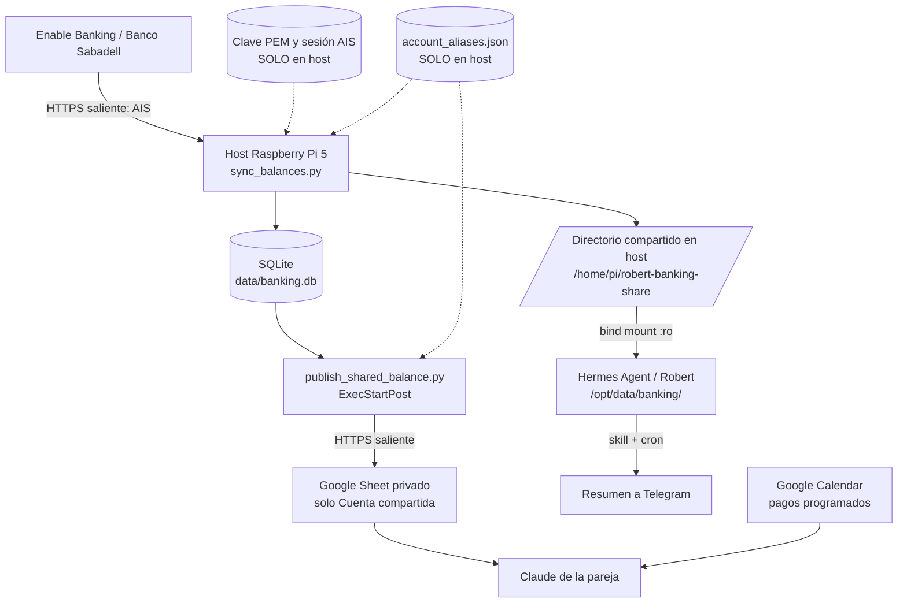

# Robert Banking

**Sincronización de saldos de Banco Sabadell con Enable Banking, SQLite, Hermes Agent y Google Sheets.**

> Proyecto personal de **consulta de información bancaria en modo solo lectura** (AIS). La Raspberry Pi ejecuta el acceso al banco; Hermes/Robert consume únicamente archivos de resultados. De manera independiente, se publica **solo el saldo contable de la cuenta compartida** en un Google Sheet privado. No se inician transferencias ni se ejecutan pagos.
>
> 
> **Alcance de este README (noviembre de 2026):** la estructura del repositorio procede de la captura del proyecto; los contratos de datos, las funciones y los valores predeterminados de `sync_balances.py` proceden de su código compartido; `robert-banking.service` y el publicador se basan en los archivos compartidos durante el desarrollo. **No se ha inspeccionado el contenido de `authorize_sabadell.py`, el `SKILL.md` realmente instalado ni el `docker-compose`/stack efectivo de Hermes.** En esas secciones se incluyen procedimientos y **ejemplos de reconstrucción**, identificados como tales; antes de reutilizarlos, compáralos con la instalación actual.

## Índice

1. [Qué hace y qué no hace](#1-qué-hace-y-qué-no-hace)
2. [Arquitectura y flujos](#2-arquitectura-y-flujos)
3. [Estructura del proyecto](#3-estructura-del-proyecto)
4. [Archivos excluidos de Git y cómo recrearlos](#4-archivos-excluidos-de-git-y-cómo-recrearlos)
5. [Modelo de datos, saldos y formatos de salida](#5-modelo-de-datos-saldos-y-formatos-de-salida)
6. [Instalación desde cero](#6-instalación-desde-cero)
7. [Servicio systemd y cron de Linux](#7-servicio-systemd-y-cron-de-linux)
8. [Carpeta compartida entre la Raspberry y Hermes](#8-carpeta-compartida-entre-la-raspberry-y-hermes)
9. [Skill `banking-monitor` y cron de Hermes](#9-skill-banking-monitor-y-cron-de-hermes)
10. [Publicación a Google Sheets y consumo desde Claude](#10-publicación-a-google-sheets-y-consumo-desde-claude)
11. [Pruebas y verificación](#11-pruebas-y-verificación)
12. [Errores frecuentes y mantenimiento](#12-errores-frecuentes-y-mantenimiento)
13. [Seguridad, copias y restauración](#13-seguridad-copias-y-restauración)
14. [Referencias y puntos pendientes](#14-referencias-y-puntos-pendientes)

## 1. Qué hace y qué no hace

Este proyecto permite:

- Consultar periódicamente los saldos de **dos cuentas** de Banco Sabadell mediante la API AIS de Enable Banking: **Cuenta compartida** y **Cuenta personal**.
- Guardar un histórico local de *snapshots* en **SQLite**, evitando que la identidad de la cuenta dependa de su posición en la respuesta de la API.
- Generar cuatro artefactos de lectura para **Robert**, un agente basado en **Hermes Agent** dentro de Docker.
- Enviar un resumen programado mediante el **cron de Hermes** (p. ej. Telegram), tomando las cifras del informe determinista generado por Python.
- Publicar **exclusivamente la Cuenta compartida** en un Google Sheet privado, para que otro asistente (Claude) pueda relacionar su saldo con los pagos previstos en Google Calendar.

**No hace:** pagos, transferencias, modificaciones de cuentas, descarga de movimientos bancarios en la versión actual, acceso directo de Hermes al banco ni acceso de Claude a las claves de Enable Banking.

### Terminología importante

- **`CLBD`**: saldo contable (*closing booked balance*); **no equivale necesariamente al saldo disponible**.
- **`XPCD`**: saldo esperado, si el banco lo proporciona; tampoco debe rotularse como disponible.
- **`fetched_at`**: instante UTC en que nuestro script terminó la consulta.
- **`reference_date`**: fecha de referencia informada por el banco para ese saldo; puede ser distinta de la fecha de consulta.
- **`identification_hash`**: identificador de la cuenta, utilizado para mantener la misma identidad entre sesiones bancarias.
- **`uid`**: identificador de cuenta dentro de una sesión de Enable Banking. **Puede cambiar al renovar la autorización**.

## 2. Arquitectura y flujos



**Existen dos planificadores diferentes** y deben mantenerse separados:

| Sistema | Dónde se ejecuta | Función | Horario de referencia |
|---|---|---|---|
| `cron` de Linux + `systemd` | **Host** Raspberry Pi | Obtener saldos, persistirlos y publicar Sheets | **07:55, 12:55 y 18:55** todos los días |
| Cron integrado de Hermes | **Contenedor** Hermes | Leer resultados y enviar un informe | **08:05** diario: ejemplo usado para `Robert - Resumen Sabadell`; verificar el cron instalado |

No hay ningún servidor HTTP bancario expuesto públicamente: tanto Enable Banking como Google Sheets se consultan por **conexiones salientes** desde la Raspberry. Hermes lee el directorio montado de manera local.

## 3. Estructura del proyecto

Ruta de trabajo en la Raspberry:

```text
/home/pi/Code_Projects/robert-banking/
├── .gitignore                         # Versionado
├── README.md                          # Este documento (añadir al repositorio)
├── pyproject.toml                     # Versionado: metadatos y dependencias
├── uv.lock                            # Versionado: versiones resueltas
├── authorize_sabadell.py              # Versionado: autorización AIS (CLI no auditada aquí)
├── sync_balances.py                   # Versionado: banco → SQLite → JSON/texto
├── publish_shared_balance.py          # Versionado: SQLite → Google Sheet
├── .env                               # IGNORADO: configuración local
├── account_aliases.json               # IGNORADO: hash → alias de cuentas
├── robert_banking_production.pem      # IGNORADO: clave privada Enable Banking
├── robert_banking_sandbox.pem         # IGNORADO: clave privada sandbox
├── production_session.json            # IGNORADO: sesión AIS autorizada
├── sandbox_session.json               # IGNORADO: sesión AIS de pruebas
├── google-sheets-service-account.json # IGNORADO: credencial privada Google
├── data/                               # IGNORADO: base de datos y ficheros SQLite
│   └── banking.db
├── .venv/                              # IGNORADO: entorno virtual uv
└── __pycache__/                        # IGNORADO: archivos temporales de Python
```

> **Muy importante:** que un archivo esté *ignorado por Git* **no significa que sea prescindible**. Algunos pueden recrearse (como `.venv` o SQLite), pero otros necesitan nueva autorización o recuperación segura de claves. El repositorio de código **no constituye por sí solo un backup completo y operativo**.

### Archivos fuera del repositorio

```text
/etc/systemd/system/robert-banking.service    # Unidad systemd del host
crontab de root                               # Disparo del servicio 3 veces al día
/home/pi/robert-banking-share/                # JSON y TXT generados por el host
~/.hermes/skills/banking-monitor/SKILL.md     # Skill en el contenedor/perfil Hermes
~/.hermes/cron/jobs.json                      # Jobs del scheduler Hermes
Configuración de Portainer/Docker            # Bind mount de la carpeta compartida
Google Cloud + Google Sheet                   # Credencial/permiso y documento externo
```

Las rutas `~/.hermes/...` son **internas al perfil que ejecuta el gateway**; `~` no necesariamente es `/home/pi` dentro de Docker.

## 4. Archivos excluidos de Git y cómo recrearlos

La captura muestra estas reglas principales de `.gitignore`:

```gitignore
.env
*.pem
*sandbox_session*.json
*production_session*.json
*.db
*.db-*
data/
__pycache__/
.venv/
.pytest_cache/
account_aliases.json
google-sheets-service-account.json
```

Si en el futuro se mueve el JSON de Google a `secrets/`, **añadir `secrets/` al `.gitignore`**: la regla actual solo cubre el nombre exacto de la credencial, no cualquier archivo JSON secreto en otras ubicaciones.

### 4.1 `.env` — configuración local (NO COMMIT)

Plantilla representativa para **producción**, con rutas de la instalación existente:

```dotenv
# Enable Banking: valores reales obtenidos en el portal de Enable Banking
EB_ENV=production
EB_APP_ID=<app-id-de-enable-banking>
EB_PRIVATE_KEY=/home/pi/Code_Projects/robert-banking/robert_banking_production.pem
EB_SESSION_FILE=/home/pi/Code_Projects/robert-banking/production_session.json

# Ficheros y datos locales
EB_DB=/home/pi/Code_Projects/robert-banking/data/banking.db
EB_SHARE_DIR=/home/pi/robert-banking-share
EB_ACCOUNT_ALIASES=/home/pi/Code_Projects/robert-banking/account_aliases.json

# Publicación de la cuenta compartida
GOOGLE_SHEET_ID=<identificador-del-documento>
GOOGLE_SHEETS_CREDENTIALS=/home/pi/Code_Projects/robert-banking/google-sheets-service-account.json
```

`EB_ACCOUNT_ALIASES` es opcional: si se omite, `sync_balances.py` lee por defecto `account_aliases.json` en la raíz del proyecto. Lo mismo ocurre con `EB_DB`, `EB_SHARE_DIR`, `EB_PRIVATE_KEY` y `EB_SESSION_FILE`, aunque **es preferible fijar las rutas de producción de forma explícita** para evitar cargar por accidente la sesión sandbox (valor predeterminado del script).

**Variables que realmente leen los scripts:**

| Variable | La utiliza | Comportamiento |
|---|---|---|
| `EB_ENV` | Ambos | `sandbox` o `production`; el publicador rechaza todo lo que no sea `production` |
| `EB_APP_ID` | `sync_balances.py` | Identificador de la aplicación para crear el JWT de Enable Banking |
| `EB_PRIVATE_KEY` | `sync_balances.py` | Ruta de la clave PEM utilizada para firmar el JWT |
| `EB_SESSION_FILE` | `sync_balances.py` | Ruta de la sesión AIS ya autorizada |
| `EB_DB` | Ambos | Ruta de SQLite; por defecto `data/banking.db` |
| `EB_SHARE_DIR` | `sync_balances.py` | Directorio de salida; por defecto `/home/pi/robert-banking-share` |
| `EB_ACCOUNT_ALIASES` | Ambos, a través de `load_account_aliases()` | Ruta opcional de alias por entorno |
| `GOOGLE_SHEET_ID` | `publish_shared_balance.py` | ID extraído de la URL del Google Sheet |
| `GOOGLE_SHEETS_CREDENTIALS` | `publish_shared_balance.py` | Ruta del JSON de cuenta de servicio Google |

No es necesario almacenar de nuevo en `.env` el hash de la cuenta compartida: se obtiene del mapa de alias.

### 4.2 Claves `*.pem` — privada de Enable Banking

Son ficheros PEM con la **clave privada RSA** asociada a la aplicación/sandbox correspondiente. `sync_balances.py` lee la clave y firma un JWT con el algoritmo `RS256`, cabecera `kid=EB_APP_ID`, audiencia `api.enablebanking.com`, emisor `enablebanking.com` y caducidad del token de **1 hora** por ejecución.

- **Producción:** `robert_banking_production.pem`.
- **Pruebas:** `robert_banking_sandbox.pem`.
- Su contenido exacto **no se documenta ni se copia al repositorio**; se recuperan de un almacenamiento cifrado autorizado o se regeneran/registran siguiendo el procedimiento de Enable Banking.
- Asegurarse de que la **clave pública que conserva Enable Banking corresponde a la clave privada local**.

Ejemplo de permisos:

```bash
chmod 600 .env *.pem
```

**Nunca** pegar una clave privada real en un issue, chat, commit o archivo de ejemplo.

### 4.3 `production_session.json` y `sandbox_session.json` — consentimiento AIS

Estos archivos representan el **resultado de una autorización bancaria**. El sincronizador necesita, entre otros datos:

```json
{
  "aspsp": {"name": "Banco de Sabadell"},
  "access": {"valid_until": "<ISO-8601-con-zona-horaria>"},
  "accounts": [
    {"uid": "<uid-de-la-sesion>", "identification_hash": "<hash-estable-de-la-cuenta>"}
  ]
}
```

**Esquema ilustrativo del subconjunto que consume `sync_balances.py`; no es una sesión válida para copiar literalmente, ni necesariamente la forma sin transformar de la respuesta de la API.** Debe guardarse la sesión auténtica que produzca el flujo de `authorize_sabadell.py`, con los campos que exige tu sincronizador.

Cuidado con una sutileza: la API puede entregar `accounts` como lista de `uid` y datos adicionales de cuenta en `accounts_data`. El código actual de `fetch_balances()` acepta elementos `str` o `dict`, pero **si solo recibe un `uid` como string, utiliza ese `uid` como identidad**: no sirve como alias estable entre reautorizaciones. Verificar que la sesión almacenada/normalizada contiene los `identification_hash` esperados. **No construir sesiones a mano con IDs ficticios**.

La duración de la autorización **no se configura en cron**; se obtiene de `access.valid_until`, puede ser de alrededor de 180 días según banco/consentimiento y puede caducar antes. Si se revoca o expira, hay que completar una **nueva autorización bancaria**, guardar una nueva sesión y revisar que los `identification_hash` sigan coincidiendo.

```bash
chmod 600 *session*.json
```

### 4.4 `account_aliases.json` — identidad de cuentas

Archivo local fundamental para distinguir las cuentas sin depender del orden de la API:

```json
{
  "production": {
    "<identification_hash_cuenta_compartida>": "Cuenta compartida",
    "<identification_hash_cuenta_personal>": "Cuenta personal"
  },
  "sandbox": {}
}
```

Las claves de la sección `production` deben sustituirse por los **hashes reales obtenidos de la sesión autenticada o los datos de cuenta**. El script `load_account_aliases()` valida que no haya nombres duplicados para un entorno. Los alias se guardan también en `accounts.label` en SQLite.

El publicador busca **exactamente** el alias `"Cuenta compartida"` bajo `production` y exige una única coincidencia. Si se renombra, actualizar también la constante `SHARED_ACCOUNT_LABEL` en `publish_shared_balance.py`, o parametrizarla en una futura refactorización.

### 4.5 `google-sheets-service-account.json` — credencial Google

JSON descargado al crear una **cuenta de servicio** en Google Cloud. Contiene información como `type`, `project_id`, `client_email` y **`private_key`**, entre otros campos. **No incluir su contenido real en la documentación**.

Para recrearlo: crear proyecto Google Cloud → habilitar Google Sheets API → crear cuenta de servicio → generar una clave JSON *si la política de tu organización permite claves de cuenta de servicio* → guardar el archivo privado → **compartir un único Google Sheet** con `client_email` como **Editor**.

```bash
chmod 600 google-sheets-service-account.json
```

Se recomienda rotar/revocar credenciales de Google si se extravían; alternativamente, en una futura versión podrían utilizarse credenciales sin claves estáticas, si el entorno lo permite.

### 4.6 `data/` y `*.db*` — base SQLite local

`data/banking.db` se crea automáticamente en la primera sincronización correcta. No es necesario para arrancar una instalación nueva, pero **si no se restaura, se pierde el histórico de saldos**. Evitar editarlo mientras corre el servicio; para respaldos consistentes usar la API de backup de SQLite (véase [Copias](#13-seguridad-copias-y-restauración)). Los archivos `*.db-*` pueden ser auxiliares temporales de SQLite.

### 4.7 `.venv`, cachés y otros temporales

Se reconstruyen a partir de `pyproject.toml` y `uv.lock` usando `uv sync --frozen`. No se incluyen en Git.

## 5. Modelo de datos, saldos y formatos de salida

### 5.1 Secuencia real de `sync_balances.py`

1. Carga `.env`, sesión AIS y PEM; comprueba que `access.valid_until` no esté vencido y que existan cuentas.
2. Genera un JWT firmado y consulta `GET /accounts/{uid}/balances` para **todas** las cuentas autorizadas. Cada petición tiene `timeout=30` segundos.
3. Normaliza `balance_type`, `balance_amount.amount`, `currency` y `reference_date` sin perder precisión decimal al guardar en SQLite.
4. Valida las respuestas y crea un snapshot en SQLite dentro de una transacción, persistiendo cuentas/alias/saldos.
5. Genera un resumen y un `daily_report.txt` **deterministas**. Los totales solo suman `CLBD` por moneda y se comprueban contra las cifras desglosadas.
6. Escribe los artefactos mediante ficheros temporales y `os.replace()`; cada archivo se sustituye atómicamente.
7. En caso de error, escribe `status.json` en estado `error` **sin borrar `balances.json` anterior**. Por ello, el consumidor debe comprobar la **fecha** y el **estado**, no dar por vigente el último saldo encontrado.

**Nota de consistencia:** cada archivo se publica atómicamente por separado, pero el conjunto de los cuatro archivos **no es una transacción única**. Ante una caída entre publicaciones, comparar `fetched_at` y el `status.json` antes de combinar datos.

### 5.2 Tablas SQLite

| Tabla | Contenido relevante |
|---|---|
| `accounts` | `environment`, `bank`, `identification_hash`, `label`; combinación única por entorno/banco/hash |
| `snapshots` | `environment`, `bank`, `fetched_at`, `consent_valid_until` |
| `balances` | `snapshot_id`, `account_id`, `balance_type`, `currency`, `amount` (texto decimal), `reference_date` |

Cada sincronización crea un nuevo snapshot. No almacena, en su versión actual, transferencias ni movimientos individuales.

### 5.3 Archivos de intercambio con Hermes

Ubicación predeterminada en **host**: `/home/pi/robert-banking-share/` (o `EB_SHARE_DIR`). En el ejemplo de contenedor se montan en `/opt/data/banking/`.

| Archivo | Escribe | Lee | Qué contiene |
|---|---|---|---|
| `balances.json` | `sync_balances.py` | Hermes | Último resumen completo, lista de cuentas/saldos, totales `CLBD`, consentimiento y `report_text` |
| `history.json` | `sync_balances.py` | Hermes | Último snapshot de cada día **local** (`Europe/Madrid`), hasta 30 días; datos `CLBD` |
| `daily_report.txt` | `sync_balances.py` | Hermes / skill | Informe ya formateado con importes por cuenta, total contable y vencimiento del consentimiento |
| `status.json` | `sync_balances.py` | Hermes / skill | Estado de la última tentativa (`ok`/`error`), hora y mensaje; si hubo error, último éxito conocido |

**Ejemplos de formato (cifras e identidades ficticias):**

`balances.json` — fragmento representativo:

```json
{
  "schema_version": 1,
  "bank": "Banco de Sabadell",
  "environment": "production",
  "fetched_at": "2026-11-16T07:55:30+00:00",
  "consent_valid_until": "<fecha-ISO-8601>",
  "consent_days_remaining": 179,
  "account_count": 2,
  "accounts": [
    {
      "name": "Cuenta compartida",
      "balances": [
        {"type": "CLBD", "amount": "850.00", "currency": "EUR", "reference_date": "2026-11-16"}
      ]
    },
    {
      "name": "Cuenta personal",
      "balances": [
        {"type": "CLBD", "amount": "150.00", "currency": "EUR", "reference_date": "2026-11-16"}
      ]
    }
  ],
  "total_clbd_by_currency": {"EUR": "1000.00"},
  "total_clbd_complete": true,
  "report_text": "Banco de Sabadell — saldos contables\n...",
  "note": "CLBD=saldo contable; XPCD=saldo esperado; ninguno implica saldo disponible"
}
```

`history.json` — estructura simplificada:

```json
{
  "schema_version": 1,
  "bank": "Banco de Sabadell",
  "environment": "production",
  "history_type": "last_snapshot_per_calendar_day",
  "days": [
    {
      "date": "2026-11-16",
      "fetched_at": "2026-11-16T07:55:30+00:00",
      "accounts": [{"name": "Cuenta compartida", "currency": "EUR", "clbd": "850.00"}],
      "total_clbd_by_currency": {"EUR": "1000.00"}
    }
  ]
}
```

El registro de ejemplo de `history.json` omite intencionadamente la segunda cuenta por brevedad, **pero en la salida real `accounts` y el total del día incluyen todas las cuentas con CLBD**.

`status.json` en éxito:

```json
{
  "status": "ok",
  "last_attempt_at": "2026-11-16T07:55:30+00:00",
  "last_success_at": "2026-11-16T07:55:30+00:00",
  "message": "Consulta completada"
}
```

`status.json` en error (ejemplo):

```json
{
  "status": "error",
  "last_attempt_at": "2026-11-17T07:55:02+00:00",
  "last_success_at": "2026-11-16T18:55:30+00:00",
  "message": "No fue posible conectar con Enable Banking."
}
```

`daily_report.txt` contiene cifras **calculadas por Python**, no por el LLM. El agente **no debe sumar de nuevo** saldos heterogéneos, ni convertir XPCD en CLBD.

## 6. Instalación desde cero

### 6.1 Requisitos

- Raspberry Pi con Linux, Python compatible con el `pyproject.toml`, `uv`, Git y salida HTTPS.
- Un entorno Hermes Agent previamente instalado y configurado si se necesitan informes por mensajería.
- Aplicación Enable Banking válida; para acceso personal puede estar **Active + Restricted**, con las cuentas autorizadas en *Linked accounts*.
- Consentimiento bancario válido para las cuentas elegidas.
- Para Sheets: Google Cloud, Sheets API, cuenta de servicio y una hoja privada compartida explícitamente con ella.

### 6.2 Clonar e instalar dependencias

```bash
mkdir -p /home/pi/Code_Projects
cd /home/pi/Code_Projects
# git clone <URL-REAL-DEL-REPOSITORIO> robert-banking
cd robert-banking
uv sync --frozen
```

No se incluye aquí un URL de Git inventado: sustituir el comentario por el remoto real. El código importado necesita `PyJWT` (`jwt`), `requests`, `python-dotenv`; el publicador además requiere `gspread` y `google-auth`. Comprobar que están declarados en `pyproject.toml`/`uv.lock`; si faltan:

```bash
uv add PyJWT requests python-dotenv gspread google-auth
```

`uv add` actualiza `pyproject.toml` y `uv.lock`: **versionar ambos cambios**. No usar `uv pip install` como mecanismo de reproducibilidad si las dependencias no quedan registradas.

### 6.3 Restaurar los archivos privados

1. Crear `.env` con el esquema de [4.1](#41-env--configuración-local-no-commit).
2. Colocar la clave de producción `robert_banking_production.pem` que corresponda a la **clave pública configurada en Enable Banking**.
3. Completar el flujo de autorización AIS con `authorize_sabadell.py` y guardar su sesión real en `production_session.json`. **No se documentan argumentos CLI inventados**, porque el contenido de ese script no fue inspeccionado en la preparación de este README.
4. Crear `account_aliases.json` con los `identification_hash` efectivos y los alias `Cuenta compartida` / `Cuenta personal`.
5. Crear el JSON de cuenta de servicio Google y el Google Sheet. La integración de Sheets puede posponerse hasta tener funcionando la sincronización bancaria.

El procedimiento de autorización de Enable Banking consta, a grandes rasgos, de iniciar `POST /auth`, completar autenticación bancaria y crear la sesión con `POST /sessions` a partir del código de autorización. **Usar el script existente**, revisar sus instrucciones y no pegar identificadores de sesión ni códigos de autorización en documentación pública.

Comprobar que la sesión y los alias coinciden sin imprimir secretos:

```bash
.venv/bin/python - <<'PY'
from pathlib import Path
from dotenv import load_dotenv
from sync_balances import load_account_aliases
load_dotenv('.env')
print('Alias configurados:', list(load_account_aliases('production').values()))
print('Fichero de sesión presente:', Path('production_session.json').is_file())
PY
```

### 6.4 Preparar el directorio de salida y permisos

```bash
sudo install -d -o pi -g pi -m 700 /home/pi/robert-banking-share
mkdir -p data
chmod 700 data
chmod 600 .env *.pem *session*.json account_aliases.json
# Si existe la credencial de Google en la raíz:
chmod 600 google-sheets-service-account.json
```

El usuario que ejecuta systemd es `pi`, por lo que debe poder **leer** los secretos y **escribir** en `data/` y `EB_SHARE_DIR`.

### 6.5 Primera sincronización

```bash
cd /home/pi/Code_Projects/robert-banking
.venv/bin/python sync_balances.py
.venv/bin/python -m json.tool /home/pi/robert-banking-share/status.json
cat /home/pi/robert-banking-share/daily_report.txt
```

Si falla, consultar el estado, confirmar `EB_ENV=production`, revisar `access.valid_until` de la sesión **sin publicarlo**, y revisar los logs/HTTP de Enable Banking. `sync_balances.py` devuelve código de salida distinto de cero en caso de error.

## 7. Servicio systemd y cron de Linux

### 7.1 Unidad de servicio

Archivo del host: `/etc/systemd/system/robert-banking.service`.

```ini
[Unit]
Description=Robert Banking - Sincronización de saldos y publicación de cuenta compartida
Wants=network-online.target
After=network-online.target

[Service]
Type=oneshot
User=pi
Group=pi
UMask=0077
WorkingDirectory=/home/pi/Code_Projects/robert-banking
EnvironmentFile=/home/pi/Code_Projects/robert-banking/.env
Environment=PYTHONDONTWRITEBYTECODE=1
ExecStart=/home/pi/Code_Projects/robert-banking/.venv/bin/python /home/pi/Code_Projects/robert-banking/sync_balances.py
ExecStartPost=-/home/pi/Code_Projects/robert-banking/.venv/bin/python /home/pi/Code_Projects/robert-banking/publish_shared_balance.py
TimeoutStartSec=240
NoNewPrivileges=true
```

- `Type=oneshot`: se inicia, ejecuta los scripts y termina; **no es un demonio permanente**.
- `EnvironmentFile`: systemd carga las variables del `.env`; los scripts también lo hacen con `python-dotenv`.
- `UMask=0077`: restringe permisos de nuevos archivos.
- `ExecStartPost`: solo se alcanza si `ExecStart` termina exitosamente.
- El prefijo **`-`** ante el publicador hace que un error de subida a Sheets **no marque la sincronización bancaria como fallida**. Ese error **sí aparecerá en el journal**: se debe vigilar por separado.
- `TimeoutStartSec=240`: tiempo máximo para los comandos de arranque de esta unidad.
- No se necesita `[Install]` / `WantedBy=multi-user.target` porque el disparador previsto es cron, no el inicio automático del sistema.

Instalación y prueba:

```bash
sudo nano /etc/systemd/system/robert-banking.service
sudo systemctl daemon-reload
sudo systemctl start robert-banking.service
sudo systemctl status robert-banking.service --no-pager
sudo journalctl -u robert-banking.service -n 100 --no-pager
```

Después de una ejecución correcta, `inactive (dead)` **es normal** para `Type=oneshot`.

### 7.2 Crontab del host

Se edita el **crontab de root** porque llama a `systemctl start`:

```bash
sudo crontab -e
```

```cron
# m h dom mon dow command
55 7,12,18 * * * /usr/bin/systemctl start robert-banking.service
```

En la zona horaria local `Europe/Madrid`, esto dispara el servicio todos los días a las **07:55**, **12:55** y **18:55**. Confirmar la zona del host con:

```bash
timedatectl
sudo crontab -l
```

No hace falta reiniciar cron después de editar el crontab. El cron del host **no tiene relación con el cron de Hermes**.

## 8. Carpeta compartida entre la Raspberry y Hermes

El programa bancario **no vive dentro del contenedor**: se ejecuta en el host con credenciales bancarias que el contenedor no debe ver.

### 8.1 Directorio del host

```text
/home/pi/robert-banking-share/
├── balances.json
├── history.json
├── daily_report.txt
└── status.json
```

`sync_balances.py` **escribe** estos cuatro archivos. El contenedor de Hermes únicamente los **lee**. SQLite, `.env`, PEM y sesiones **no deben montarse dentro del contenedor**.

### 8.2 Ejemplo de bind mount en Portainer / Docker

**Ejemplo de reconstrucción: comprobar que coincide con el stack real.** Añadir al servicio/contenedor Hermes:

```yaml
services:
  hermes:
    volumes:
      - /home/pi/robert-banking-share:/opt/data/banking:ro
```

`ro` es **read-only desde el contenedor**. En este ejemplo:

| Host Raspberry | Dentro del contenedor Hermes |
|---|---|
| `/home/pi/robert-banking-share/status.json` | `/opt/data/banking/status.json` |
| `/home/pi/robert-banking-share/balances.json` | `/opt/data/banking/balances.json` |
| `/home/pi/robert-banking-share/history.json` | `/opt/data/banking/history.json` |
| `/home/pi/robert-banking-share/daily_report.txt` | `/opt/data/banking/daily_report.txt` |

Verificar el nombre del contenedor en Portainer o con `docker ps`, y después:

```bash
docker exec <NOMBRE_O_ID_DEL_CONTENEDOR_HERMES> \
  sh -c 'id; ls -la /opt/data/banking; cat /opt/data/banking/status.json'
```

> **Permisos:** el host publica archivos con modo `0600` y directorios restrictivos. `:ro` impide escribir, **pero no concede permiso de lectura por sí solo**. El UID/GID efectivo de Hermes debe tener acceso al directorio; en la instalación se ha utilizado la opción `HERMES_UID/HERMES_GID=1000`, que conviene verificar contra `id pi`. No resolver problemas de permisos con `chmod 777` ni montando el proyecto bancario entero.

### 8.3 Contrato para el consumidor

Orden recomendado de lectura para Robert:

1. **`status.json` primero.** Si `status != "ok"`, advertir fallo y no describir cifras antiguas como recién consultadas.
2. Comparar `last_success_at` con `balances.json.fetched_at`; advertir si las fechas no cuadran o los datos son antiguos.
3. Para un informe diario, **reproducir `daily_report.txt`** o el `report_text` del JSON, sin inventar cifras.
4. Leer `history.json` solo para preguntas sobre evolución histórica; recordar que contiene como máximo un punto por día local, no movimientos.
5. Diferenciar siempre **saldo contable** (`CLBD`) de **saldo disponible** (no garantizado).

## 9. Skill `banking-monitor` y cron de Hermes

Hermes utiliza **skills** como instrucciones cargables y tiene **su propio scheduler**. La skill enseña al agente **cómo interpretar los archivos**; el cron decide **cuándo invocarla**. No es un servidor MCP y no tiene acceso directo a Enable Banking.

### 9.1 Dónde se guarda la skill

Según la instalación estándar de Hermes, las skills están en `~/.hermes/skills/`. Para esta instalación se ha utilizado el nombre **`banking-monitor`** y la ruta de datos `/opt/data/banking/`.

```text
~/.hermes/skills/
└── banking-monitor/
    └── SKILL.md
```

La ubicación corresponde **al sistema de archivos del perfil Hermes dentro de Docker**; debe estar cubierta por el volumen persistente de Hermes si quieres conservarla al recrear el contenedor.

### 9.2 Contenido propuesto para `banking-monitor/SKILL.md`

> **Plantilla de reconstrucción, NO transcripción comprobada de la skill actualmente instalada.** Es seguro versionar esta plantilla en el futuro dentro de `docs/hermes/banking-monitor/SKILL.md` si no contiene datos reales.

````markdown
---
name: banking-monitor
description: Lee y explica los informes bancarios de Robert desde archivos locales de solo lectura.
---

# Banking Monitor (read-only)

## Fuente única de datos
- Directorio: `/opt/data/banking/`.
- Leer `status.json` antes de cualquier respuesta.
- En un informe diario usar `daily_report.txt` literalmente como fuente de importes.
- `balances.json` sirve para preguntas sobre el último snapshot.
- `history.json` sirve únicamente para tendencias por días, no para movimientos.

## Procedimiento
1. Abrir y validar `status.json`.
2. Si `status=error`, informar del fallo y de `last_success_at`.
3. Si no hay informe o es antiguo, explicitar la antigüedad.
4. Si `status=ok`, leer `daily_report.txt` y reproducir sus importes.
5. Para preguntas adicionales, consultar `balances.json` / `history.json`.

## Reglas críticas
- Nunca afirmar que `CLBD` es saldo disponible.
- Nunca mezclar `CLBD` con `XPCD` o sumar tipos de saldo distintos.
- Nunca recalcular el total del informe con el LLM ni inventar cifras.
- Nunca leer o solicitar PEM, tokens, sesiones, `.env` o IBAN completos.
- Nunca modificar archivos bancarios ni iniciar pagos.
- No confundir una consulta antigua con datos en tiempo real.
````

En una instalación nueva, copiar esta plantilla al directorio de skills del perfil **y probar su invocación**. Si ya existe una skill más completa, usar su contenido real como fuente y actualizar este README, en vez de sobrescribirla sin revisión.

### 9.3 Cron de Hermes: resumen matutino

En las conversaciones de configuración se utilizó el nombre **`Robert - Resumen Sabadell`** y se propuso una programación a las **08:05 (Europe/Madrid)**, después de la primera sincronización del host a las 07:55. **No se ha comprobado el job actualmente guardado por Hermes; el comando siguiente reconstruye ese comportamiento propuesto.**

```bash
hermes cron create '5 8 * * *' \
  'Usa la skill banking-monitor. Comprueba /opt/data/banking/status.json y, si el estado es ok y la consulta es reciente, reproduce fielmente /opt/data/banking/daily_report.txt. No recalcules importes. Si hubo fallo o los datos están desactualizados, avisa explícitamente. No presentes CLBD como disponible.' \
  --timezone Europe/Madrid \
  --skill banking-monitor \
  --name 'Robert - Resumen Sabadell' \
  --deliver telegram
```

Este comando **crea un job nuevo**. Antes de ejecutarlo en una instalación donde Robert ya funciona, listar los jobs para **evitar duplicados**:

```bash
hermes cron list
hermes cron status
# Probar un job existente por su identificador (no crear otro):
hermes cron run <JOB_ID>
```

Los jobs están guardados por Hermes en `~/.hermes/cron/jobs.json`, **fuera del repositorio bancario**; se ejecutan desde el gateway, en sesiones independientes del chat. Para recibir por Telegram, el gateway debe tener previamente configurado ese canal. Guardar la definición del job (sin secretos) en la documentación o como recurso de despliegue si se desea reproducirlo automáticamente.

**Temporización:** `08:05` deja 10 minutos respecto del cron de host de `07:55`. Si la Raspberry estaba apagada, si la llamada a Sabadell falló o si la sincronización se retrasa, Robert debe reconocerlo leyendo `status.json` y la marca temporal. Un cron de Hermes **no fuerza por sí mismo** la sincronización bancaria.

## 10. Publicación a Google Sheets y consumo desde Claude

### 10.1 Qué hace `publish_shared_balance.py`

El publicador:

1. Exige `EB_ENV=production`.
2. Llama a `load_account_aliases('production')` desde `sync_balances.py` y localiza **exactamente una** `Cuenta compartida`.
3. Abre SQLite en **modo lectura** y selecciona el snapshot más reciente de `production`.
4. Extrae **exactamente un saldo `CLBD` en `EUR`** para ese `identification_hash`; comprueba la etiqueta almacenada.
5. Publica la información en **el primer tab** del Google Sheet configurado, rango `A1:F2`.

No consulta de nuevo a Enable Banking ni publica los importes de `Cuenta personal`.

Campos en el Sheet:

| Columna | Contenido |
|---|---|
| `A` Cuenta | `Cuenta compartida` |
| `B` Saldo contable (EUR) | Número `CLBD` de esa cuenta |
| `C` Saldo disponible (EUR) | **En blanco**: el script no lo conoce |
| `D` Última consulta | `fetched_at` convertido a `Europe/Madrid` |
| `E` Referencia del banco | `reference_date`, si viene en la API |
| `F` Tipo de saldo | `CLBD (contable)` |

**Ojo con la antigüedad:** la versión de `publish_shared_balance.py` compartida durante el desarrollo contenía una **barrera de 30 minutos** para no publicar snapshots antiguos. Posteriormente se acordó que era preferible publicar el último dato disponible y enseñar su fecha, manteniendo únicamente la comprobación de fechas futuras. **La captura del repositorio no permite verificar si esa modificación ya se aplicó al archivo local**. Revisar el bloque `age = ...` del archivo real: si sigue rechazando `age > timedelta(minutes=30)`, esa condición explica los errores al publicar manualmente tiempo después de sincronizar. No confundir el error del publicador con un fallo de la consulta bancaria.

### 10.2 Configuración de Google

1. Crear un Google Sheet privado, por ejemplo **Finanzas compartidas - Robert**.
2. En Google Cloud, habilitar **Google Sheets API**, crear una cuenta de servicio y obtener credenciales JSON.
3. Guardar el JSON en el host, referido por `GOOGLE_SHEETS_CREDENTIALS`.
4. Compartir **solo esa hoja** con el `client_email` de la cuenta de servicio, rol **Editor**.
5. Compartirla con la pareja, rol **Lector**. Mantener `Acceso general: Restringido`.
6. Poner el ID del documento (segmento entre `/d/` y `/edit` en su URL) en `GOOGLE_SHEET_ID`.

No hay que publicar la hoja ni abrir ningún puerto en el router. Google Sheets es un **destino de publicación**, no el lugar donde se almacenan las claves de banco.

### 10.3 Pruebas del publicador

```bash
cd /home/pi/Code_Projects/robert-banking
.venv/bin/python publish_shared_balance.py --dry-run  # solo valida selección/SQLite
.venv/bin/python publish_shared_balance.py            # escribe realmente el Sheet
```

El `--dry-run` de este script comprueba datos locales **sin contactar con Google**. Si la publicación falla pero `ExecStart` fue correcta, la unidad puede terminar sin fallo gracias al prefijo `-` en `ExecStartPost`; consultar siempre el journal y la fecha de la hoja.

### 10.4 Claude y el calendario de pagos

Claude de la pareja puede utilizar el conector de Google Drive/Sheets para leer **esa hoja privada** y contrastarla con las fechas e importes de **Google Calendar**, si su modalidad y sus automatizaciones admiten ambos conectores. Reglas sugeridas para su prompt:

- Comprobar la fecha `Última consulta` y advertir cuando sea antigua (por ejemplo, **más de 24 horas**).
- Interpretar la columna B como **saldo contable**, no como dinero garantizado para pagos.
- No inventar cargos que no figuren en Calendar ni restar movimientos supuestos.
- No mostrar otras cuentas: la hoja contiene solo la cuenta compartida.
- No inferir saldo disponible cuando su columna está vacía.

El Google Sheet y su permiso para Claude son **independientes** de la skill y cron de Hermes.

## 11. Pruebas y verificación

### 11.1 Host: permisos, dependencias y salud

```bash
cd /home/pi/Code_Projects/robert-banking
uv sync --frozen
.venv/bin/python -m py_compile sync_balances.py publish_shared_balance.py
sudo systemctl cat robert-banking.service
sudo systemctl start robert-banking.service
sudo journalctl -u robert-banking.service --since today --no-pager
sudo crontab -l
```

### 11.2 Datos de salida

```bash
ls -lah /home/pi/robert-banking-share
.venv/bin/python -m json.tool /home/pi/robert-banking-share/status.json
.venv/bin/python -m json.tool /home/pi/robert-banking-share/balances.json >/dev/null
cat /home/pi/robert-banking-share/daily_report.txt
```

### 11.3 Comprobar la base sin volcar importes al terminal

```bash
.venv/bin/python - <<'PY'
import os, sqlite3
from dotenv import load_dotenv
load_dotenv('.env')
p = os.getenv('EB_DB', 'data/banking.db')
with sqlite3.connect(p) as db:
    print('accounts:', db.execute('SELECT COUNT(*) FROM accounts').fetchone()[0])
    print('snapshots:', db.execute('SELECT COUNT(*) FROM snapshots').fetchone()[0])
    print('balances:', db.execute('SELECT COUNT(*) FROM balances').fetchone()[0])
PY
```

### 11.4 Docker y Hermes

```bash
# Reemplazar por el nombre real del contenedor
docker ps --format '{{.Names}}'
docker exec <CONTENEDOR_HERMES> sh -c \
  'test -r /opt/data/banking/daily_report.txt && echo OK-LECTURA'
# Dentro del entorno en el que existe el CLI Hermes:
hermes cron list
```

## 12. Errores frecuentes y mantenimiento

| Síntoma | Posible causa | Qué comprobar |
|---|---|---|
| `ConsentExpired` | `access.valid_until` ya pasó | Reautorizar la cuenta y guardar nueva sesión válida |
| HTTP 401 / `EXPIRED_SESSION` | Revocación temprana o sesión inválida | No fiarse solo de la fecha: revisar código de error y reautorizar |
| `EB_ENV` no es production | Variable ausente o equivocada | `.env` y `EnvironmentFile` de systemd |
| Alias desconocido o no coincide | `account_aliases.json` incompleto o nuevo hash | Revisar identidades de sesión y alias; evitar comparar por orden |
| `CLBD` ausente | Banco no proporciona ese tipo para una cuenta | No inventar saldo ni sumarlo con `XPCD` |
| `SQLite` no existe | `EB_DB` incorrecto o nunca se sincronizó | Crear `data/`, revisar permisos y ejecutar `sync_balances.py` |
| `status.json` en error, `balances.json` presente | Falló el último intento pero quedó el snapshot anterior | Leer `last_success_at`, `fetched_at` y tratarlo como dato antiguo |
| No se publica Sheets pero el banco funciona | Credenciales Google, API, permisos o antigüedad | Ejecutar publicador manual y revisar `journalctl` |
| Google `SpreadsheetNotFound` o 403 | ID de hoja erróneo / falta compartir con service account | Comprobar `GOOGLE_SHEET_ID` y `client_email` como Editor |
| Error `más de 30 minutos` | Filtro de antigüedad del publicador anterior | Revisar si el código aún mantiene ese límite |
| Hermes no puede leer archivos | Bind mount incorrecto o usuario/UID sin permisos | Revisar ruta `:ro`, `docker exec ... id`, permisos 700/600 |
| Telegram no envía el resumen | Gateway parado, job ausente, canal no configurado | `hermes cron status`, `hermes cron list` y logs del gateway |
| La unidad figura `inactive (dead)` | Normal en `Type=oneshot` | Revisar el código de salida y el journal, no exigir `active (running)` |

### Renovación de consentimiento

1. Comprobar el `consent_valid_until` o el informe diario; planificar la renovación antes de la fecha límite.
2. Completar **una nueva autorización del usuario** desde `authorize_sabadell.py`/Enable Banking.
3. Guardar la sesión actualizada en el archivo configurado por `EB_SESSION_FILE`.
4. Comprobar que los `identification_hash` permiten asociar correctamente las cuentas nuevas con los alias existentes.
5. Ejecutar una sincronización manual y comprobar `status.json`, informe y publicación a Sheets.

### Sobre la zona horaria y los límites del histórico

- Los instantes de consulta se guardan en UTC (con zona horaria).
- Los informes y el histórico diario se presentan/agrupan por `Europe/Madrid`.
- El histórico de Hermes conserva como máximo **30 días** y toma el último snapshot por día local; SQLite conserva todos los snapshots almacenados, salvo mantenimiento manual.

## 13. Seguridad, copias y restauración

### 13.1 Principios de separación

- **Host Raspberry:** PEM, `.env`, sesión AIS, hashes, SQLite; ejecuta las consultas a Enable Banking y la publicación a Google.
- **Hermes/Docker:** solo cuatro archivos exportados y, preferentemente, montados `:ro`; nunca el directorio bancario entero.
- **Google Sheets:** solo CLBD de `Cuenta compartida` y fechas, nunca los datos de `Cuenta personal` ni credenciales.
- **Claude:** acceso por permisos Google al documento compartido, no al host ni a la API bancaria.

Evitar `privileged: true`, montar `/var/run/docker.sock`, montar `/` o `/home/pi/Code_Projects/robert-banking` dentro del contenedor para resolver permisos.

### 13.2 Qué respaldar

| Objeto | Versionar en Git | Copia privada/cifrada | Reproducible sin backup |
|---|---:|---:|---:|
| Código, `pyproject.toml`, `uv.lock`, README | Sí | Opcional | Sí, desde Git |
| `.env` | **No** | Sí (sin divulgar) | Sí, reconfigurando valores |
| PEM de producción / sandbox | **No** | Sí, con control estricto | Solo regenerando/registrando según proveedor |
| Sesiones JSON | **No** | Según política de seguridad | Nueva autorización bancaria |
| `account_aliases.json` | **No** en esta configuración | Sí, cifrada | Sí, si se recuperan hashes/alias correctos |
| `google-sheets-service-account.json` | **No** | Según política de claves | Sí, generando nueva credencial y revocando antigua |
| `data/banking.db` | **No** | **Sí**, si importa conservar histórico | No: se inicia nuevo histórico |
| `robert-banking.service` y crontab | Actualmente fuera del repo | **Sí**, o documentarlos/exportarlos | Sí, siguiendo este README |
| Skill y jobs de Hermes | Actualmente fuera del repo | **Sí**, respaldar sin secretos | Parcial: aquí hay una plantilla, no copia de su estado real |
| Directorio `/home/pi/robert-banking-share` | **No** | Opcional | Sí, tras sincronización correcta |

Backup consistente de SQLite:

```bash
cd /home/pi/Code_Projects/robert-banking
.venv/bin/python - <<'PY'
import os, sqlite3
from dotenv import load_dotenv
load_dotenv('.env')
source = os.getenv('EB_DB', 'data/banking.db')
with sqlite3.connect(source) as src, sqlite3.connect('/home/pi/banking-backup.db') as dst:
    src.backup(dst)
print('Backup SQLite creado en /home/pi/banking-backup.db')
PY
chmod 600 /home/pi/banking-backup.db
```

**Importante:** mover el backup a un soporte **cifrado** con permisos adecuados. El ejemplo lo crea en el host y **no lo cifra automáticamente**.

### 13.3 Lista de restauración

- [ ] Recuperar Git y `uv sync --frozen`.
- [ ] Restaurar `.env`, PEM y sesiones **o generar una nueva autorización válida**.
- [ ] Restaurar/reconstruir `account_aliases.json`; comprobar nombres exactos y hashes.
- [ ] Restaurar `banking.db` si se necesita el histórico; en otro caso, crear uno nuevo.
- [ ] Reconstruir Google Sheet + cuenta de servicio/permisos y configurar su ID.
- [ ] Crear `EB_SHARE_DIR`, ajustar propietarios/permisos y ejecutar sincronización manual.
- [ ] Instalar systemd y el crontab del host.
- [ ] Restaurar volumen persistente de Hermes y su configuración de Telegram.
- [ ] Restaurar el bind mount `:ro`, skill y definición del job de Hermes.
- [ ] Comprobar las fechas y los importes sin confundir CLBD y disponible.

## 14. Referencias y puntos pendientes

### Documentación oficial

- [Enable Banking — Quick Start API](https://enablebanking.com/docs/api/quick-start/)
- [Enable Banking — API Reference](https://enablebanking.com/docs/api/reference/)
- [Enable Banking — FAQ: sesiones, caducidad y reautorización](https://enablebanking.com/docs/faq/)
- [Hermes — Skills System](https://hermes-agent.nousresearch.com/docs/user-guide/features/skills)
- [Hermes — Creating Skills](https://hermes-agent.nousresearch.com/docs/developer-guide/creating-skills)
- [Hermes — Scheduled Tasks (Cron)](https://hermes-agent.nousresearch.com/docs/user-guide/features/cron)

### Para dejar esta documentación 100 % equivalente al despliegue real

Este README está diseñado para que el proyecto sea reproducible, pero todavía hay algunos **elementos externos al repositorio cuyo contenido exacto no ha sido contrastado**:

1. **`authorize_sabadell.py`:** documentar su CLI real, sus parámetros y cómo guarda la sesión normalizada.
2. **`SKILL.md` instalado en Hermes:** exportar su versión actual (sin información personal) y contrastarla con la plantilla de este README.
3. **Cron real de Hermes:** guardar la salida de `hermes cron list` y el prompt/configuración del job `Robert - Resumen Sabadell` sin identificadores de chat ni secretos.
4. **Stack de Docker/Portainer:** conservar un ejemplo del volumen real y de los IDs de usuario usados, sin tokens.
5. **Publicador de Sheets:** confirmar si ya se eliminó el filtro de antigüedad de 30 minutos en el código del repositorio.
6. **Configuración del servicio:** conservar una copia versionada de la unidad systemd (no contiene secretos) o automatizar su instalación.

Con esas seis comprobaciones se podría convertir este README, que ya cubre contratos y procedimientos de reconstrucción, en una **documentación fiel al 100 % de la instalación concreta**.
